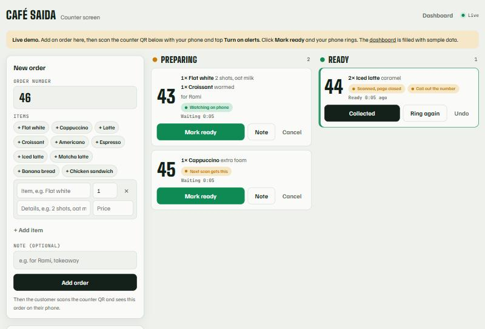
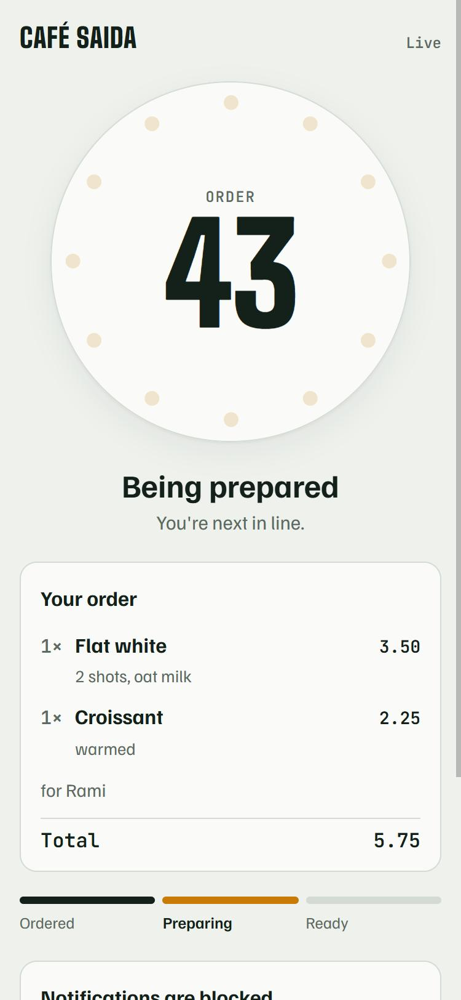
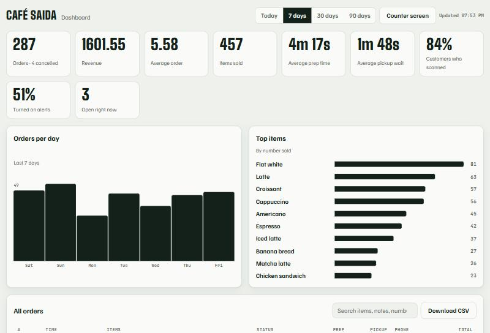

# Ding: the customer's phone is the pager

**Ding replaces the plastic buzzers at coffee shops and food counters.** The cashier enters the order, the customer scans one QR code on the counter, and their own phone shows the order and rings when it's ready. No app to install, no hardware to buy, charge or lose.

**Try it yourself:** run `node start.js` (Node 18+, nothing to install). It prints a public https link: open it on a laptop, then scan the counter QR with your phone. Or deploy your own copy in one click with the included `render.yaml` (see [Deploy](#deploy-free-demo-on-render)).

| Counter screen (staff) | Customer's phone | Owner dashboard |
|---|---|---|
|  |  |  |

## How it works

1. **The cashier enters the order** on the counter screen: items, options (for example "Flat white, 2 shots, oat milk") and prices. Items used before turn into one-tap buttons.
2. **The customer scans the single QR code** on the counter. Their phone picks up the order the cashier just entered and shows every item, the total, their place in the queue and a timer. If they scan first, the phone waits and picks the order up the moment it's entered.
3. **The customer taps "Turn on alerts"**, which is one browser permission prompt.
4. **Staff tap "Mark ready".** The phone gets a push notification (even when locked), flashes green full-screen, plays a bell and vibrates. "Ring again" sends a reminder.
5. **The owner dashboard** shows orders, revenue, average order value, preparation and pickup times, top items, busiest hours or days, and how many customers scanned or turned on alerts. It covers today, 7, 30 or 90 days, has a searchable order table, and exports to CSV.

## Technical highlights

- **No dependencies.** Plain Node.js (18+) standard library only: no npm packages, no framework, no database.
- **Web Push written from scratch** in `webpush.js`: VAPID signing (RFC 8292) and aes128gcm payload encryption (RFC 8291). It works with Chrome/Android, Firefox and Safari on iOS 16.4+.
- **Real-time updates** with Server-Sent Events, plus an automatic **polling fallback** when a proxy holds back streaming responses. Cloudflare quick tunnels, for example, buffer SSE; the pages detect this within 4 seconds and switch over.
- **One shared QR code instead of one per order.** Scans claim the newest unclaimed order from the last 15 minutes. A cookie makes rescans return the same order, and the claim is a POST, so link previews never use one up.
- **Service worker** for lock-screen notifications. On iPhone, the page guides customers through "Add to Home Screen", as Apple requires.
- **Analytics** computed from 90 days of order history kept in a JSON file, with charts drawn in plain HTML/CSS.
- **Demo mode** (`DEMO=1`) fills the store with two weeks of realistic sample orders and adds spam limits for a public demo.

## Run it locally

Needs only [Node.js](https://nodejs.org) 18 or newer. No `npm install`.

```bash
node server.js
```

Open http://localhost:3000 for the counter screen and http://localhost:3000/dashboard for the dashboard. To try it with a real phone (push needs https), run `node start.js`. It opens a temporary public https link through a Cloudflare quick tunnel. On Windows, double-click `Start Ding.bat`.

### Settings (environment variables)

| Variable | What it does | Example |
|---|---|---|
| `SHOP_NAME` | Name shown on all screens | `Café Saida` |
| `STAFF_PIN` | PIN for the counter screen and dashboard (use it for any real shop) | `4821` |
| `PUBLIC_URL` | Your public https address, used in the counter QR | `https://ding.mycafe.com` |
| `DEMO` | `1` = sample data and limits for a public demo | `1` |
| `VAPID_SUBJECT` | Contact address for push services | `mailto:you@mycafe.com` |
| `PORT` | Port to listen on | `3000` |
| `DATA_DIR` | Where orders and push keys are saved | `./data` |

## Deploy (free demo on Render)

This repository includes `render.yaml`. On [render.com](https://render.com), choose **New → Blueprint** and pick this repository. Render creates a free web service running in demo mode. The free plan sleeps after 15 minutes without visitors (the first visit then takes about 30 to 60 seconds), and data resets when it restarts. That's fine for a demo.

For a real shop, use a paid instance with a persistent disk (set `DATA_DIR` to it) and set `STAFF_PIN` and `PUBLIC_URL`. Keep `data/vapid.json` once it exists: changing it breaks phones that already turned on alerts.

## Phone support

| Phone | Alerts with screen locked | With page open |
|---|---|---|
| Android (Chrome, Samsung, Firefox) | Yes, push notification with vibration | Flash, bell sound, vibration |
| iPhone, iOS 16.4+ | Yes, after **Share → Add to Home Screen** | Flash and bell sound (iPhone doesn't let websites vibrate) |
| Other browsers | No | Flash and bell sound |

## API (for connecting a POS)

Staff endpoints take the PIN in an `X-Staff-Pin` header.

```http
POST /api/staff/orders
Content-Type: application/json

{ "number": "47", "note": "takeaway", "items": [{ "name": "Flat white", "qty": 1, "details": "2 shots", "price": 3.5 }] }
```

Other staff actions are `POST /api/staff/orders/<id>/ready`, `collected`, `ping`, `cancel`, `reopen` and `note`. Reads are `GET /api/staff/orders` (live board), `GET /api/staff/history?days=7` (dashboard data) and `GET /api/staff/menu` (items used before).

## Files

```
server.js             web server, order store, live updates, staff/customer/dashboard APIs
webpush.js            Web Push sender (VAPID + aes128gcm), no dependencies
demo.js               sample data for DEMO=1
start.js              local launcher with a temporary public https link
public/staff.html     counter screen
public/join.html      what the counter QR opens: picks up the customer's order
public/customer.html  the customer's order page
public/dashboard.html owner dashboard
public/sw.js          service worker that shows notifications
render.yaml           one-click deploy to Render
```
